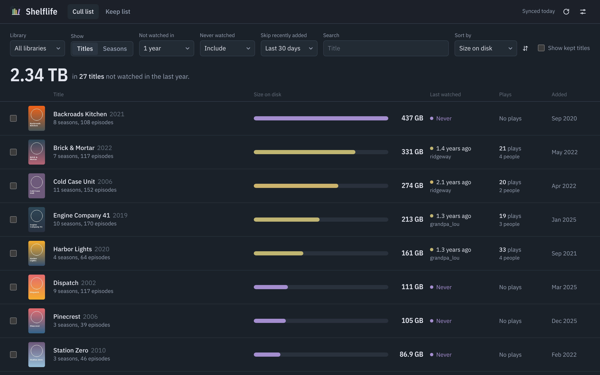
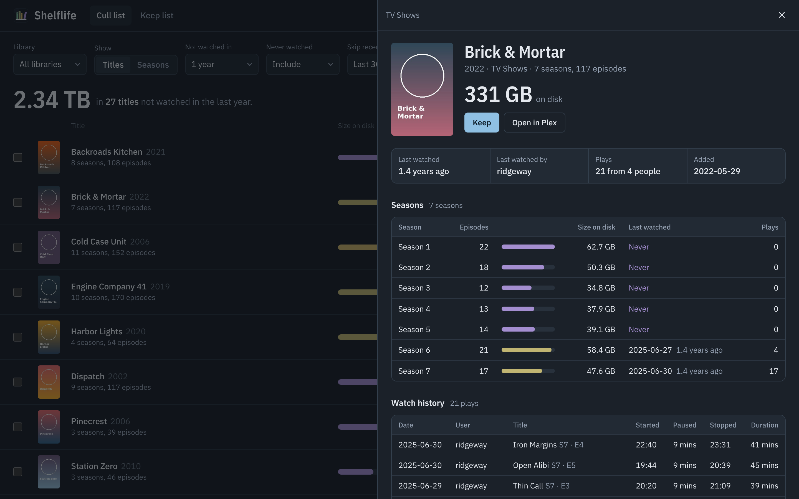
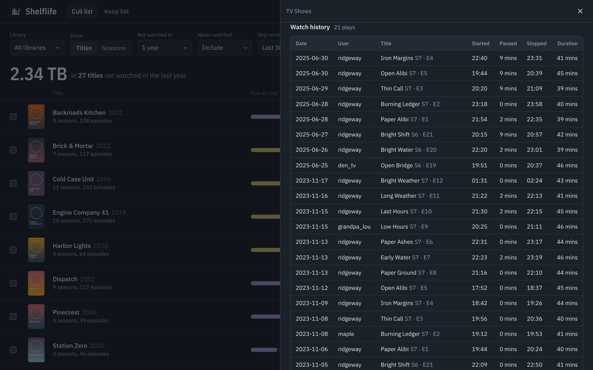
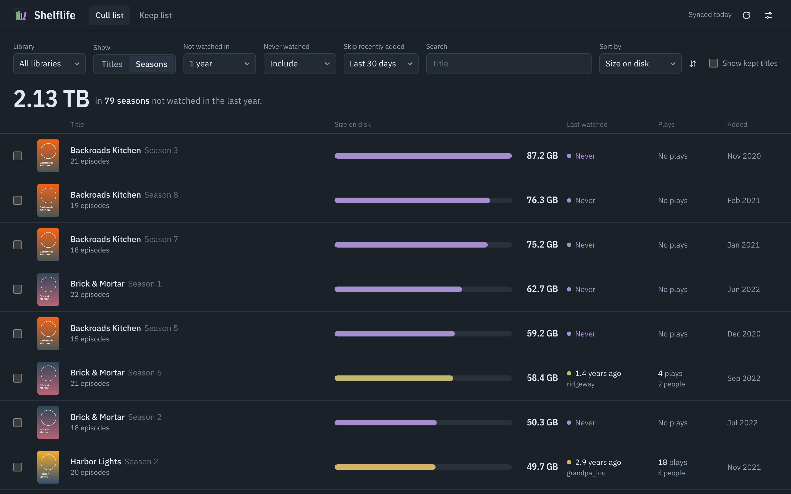
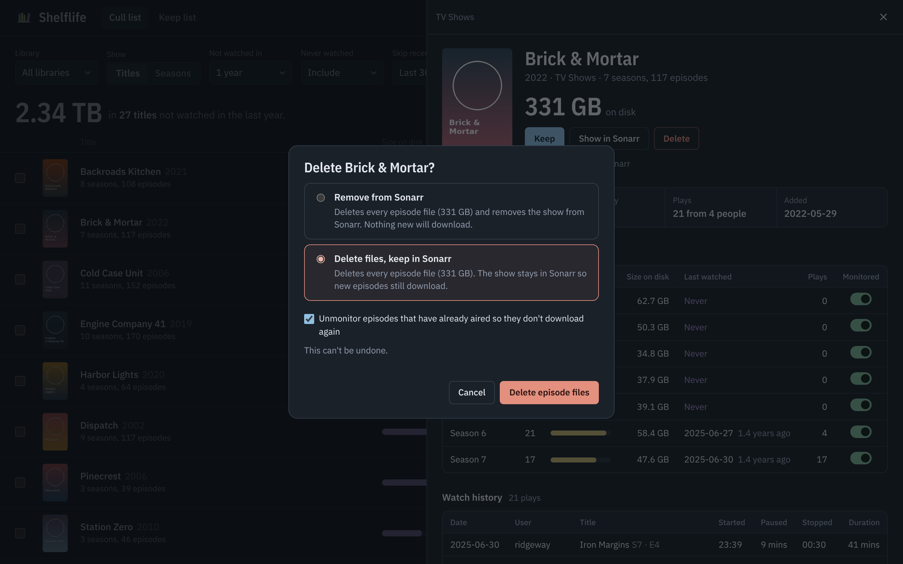
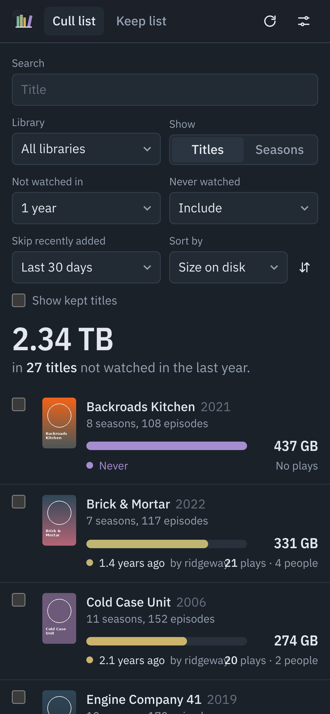
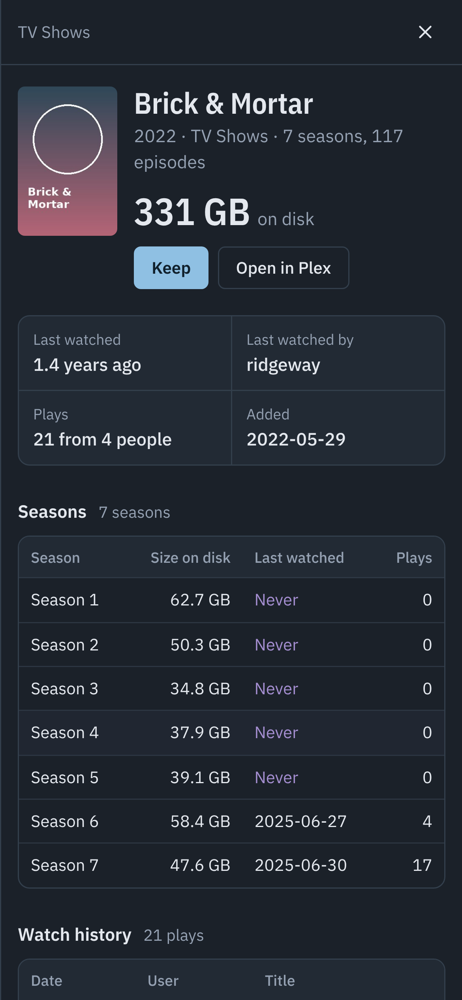
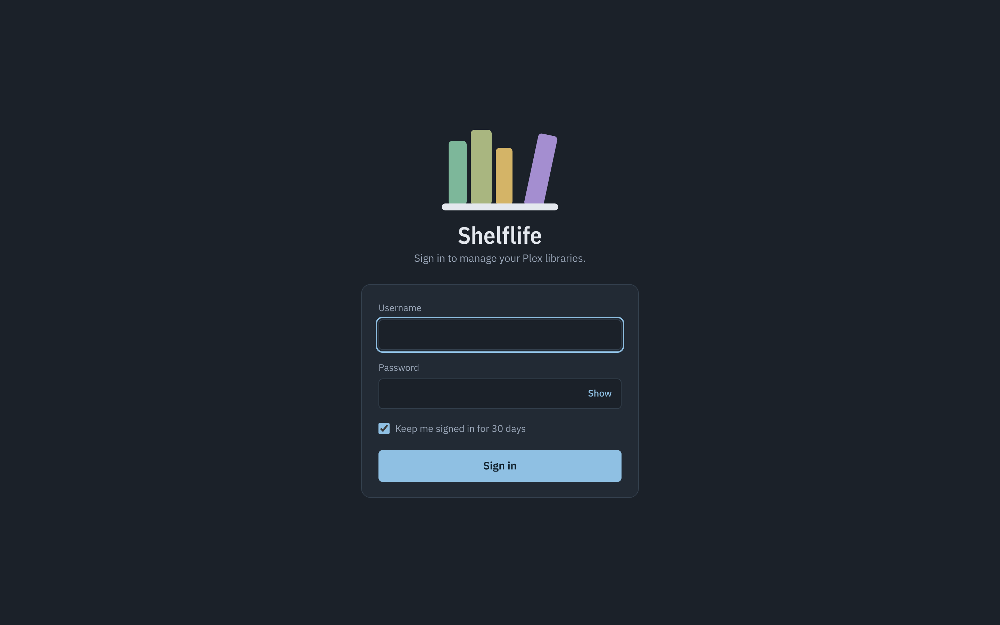
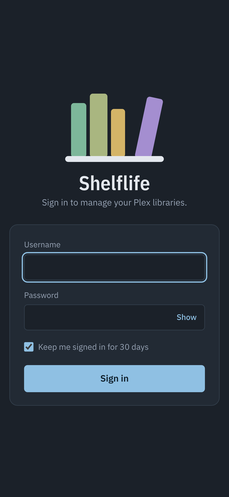

<p align="center"></p>

<h1 align="center">Shelflife</h1>

<p align="center">Find the biggest, least-watched movies and shows in your Plex libraries, using the watch history Tautulli already has.</p>



Shelflife lists every movie and TV show that nobody has watched in a while (or ever), sorted by how much disk it takes up, so you can see where culling buys back the most space. Click any title to see its full watch history, the way Tautulli shows it. Titles you'd never delete go on a keep list and stop showing up.

On its own Shelflife only reads. Connect Sonarr and Radarr and it can delete what you pick, through them, so nothing re-downloads behind your back.

## What it does

- **Cull list.** Movies and whole TV shows in one list, filtered by "not watched in" (1 month to 5 years), with never-watched titles included, left out, or shown alone. Sorts by size on disk, last watched, date added, plays or title.
- **Seasons view.** Flip to see every season of every show as its own row, sorted by size, for when the last season of a long show is the dead weight.
- **Size tinted by staleness.** Each size bar shades from sage (watched recently) to straw (years ago); violet means nobody has ever played it.
- **Skip recent additions.** By default anything added in the last 30 days is left out, so new downloads don't show up as "never watched".
- **Watch history.** Per title: date, user, title, started, paused, stopped and duration, straight from Tautulli. Shows also get a season breakdown with sizes and last-watched dates.
- **Keep list.** Keep a title from its detail page, or select several rows and keep them all at once. Keeping a show keeps all its seasons. Add a note so future-you knows why.
- **What counts as watched.** In settings, ignore plays from specific people (your test plays, a kid on loop) and plays shorter than N minutes.
- **Selection totals and CSV export.** Tick rows to see how much space they add up to, then export the list.
- **Delete through Radarr and Sonarr (optional).** Movies are removed from Radarr with their files, so they don't download again. Shows offer two choices: remove the show from Sonarr entirely, or delete every episode file but keep the show in Sonarr so new episodes still arrive. Single seasons can have their files deleted too. Kept titles can't be deleted.
- **Sonarr monitoring.** Toggle monitoring for the whole show and for each season from the detail panel.
- **Show in Sonarr / Show in Radarr** links, and **Open in Plex** when a Plex token is set. Works on phones; installable as a PWA.

| Title detail | Watch history |
| --- | --- |
|  |  |

| Seasons view | Deleting through Sonarr |
| --- | --- |
|  |  |

<p>
  
  &nbsp;
  
</p>

## Install on Unraid

1. In the Docker tab, choose **Add Container**, and paste this into **Template**:
   `https://raw.githubusercontent.com/au12/shelflife/main/templates/shelflife.xml`
   (or copy `templates/shelflife.xml` to `/boot/config/plugins/dockerMan/templates-user/my-shelflife.xml` and pick it from the template list).
2. Fill in **Tautulli URL** and **Tautulli API key** (Tautulli → Settings → Web Interface).
3. Optional: add a **Plex token** (faster syncs, Open in Plex links), and **Sonarr** / **Radarr** URLs and API keys to delete titles and manage monitoring.
4. Apply, then open the web UI on port 8585. The first sync starts on its own.

## Docker / Compose

```yaml
services:
  shelflife:
    image: ghcr.io/au12/shelflife:latest
    container_name: shelflife
    ports:
      - "8585:8585"
    volumes:
      - /mnt/user/appdata/shelflife:/config
    environment:
      TAUTULLI_URL: http://192.168.1.10:8181
      TAUTULLI_API_KEY: your-tautulli-api-key
      # PLEX_TOKEN: your-plex-token        # optional, see below
      # SONARR_URL: http://192.168.1.10:8989
      # SONARR_API_KEY: your-sonarr-api-key
      # RADARR_URL: http://192.168.1.10:7878
      # RADARR_API_KEY: your-radarr-api-key
    restart: unless-stopped
```

## Settings

| Variable | Default | What it does |
| --- | --- | --- |
| `TAUTULLI_URL` | | Tautulli base URL, including any HTTP root. Required. |
| `TAUTULLI_API_KEY` | | Tautulli API key. Required. |
| `PLEX_TOKEN` | | Optional. Reads file sizes straight from Plex (see below). |
| `PLEX_URL` | from Tautulli | Plex address, only used with a token. Defaults to the one Tautulli uses. |
| `SONARR_URL` / `SONARR_API_KEY` | | Optional. Delete shows and seasons, change monitoring. |
| `RADARR_URL` / `RADARR_API_KEY` | | Optional. Delete movies. |
| `SONARR_PUBLIC_URL` / `RADARR_PUBLIC_URL` | same as the URL | Address your browser uses for the Show in Sonarr/Radarr links, if different (e.g. behind a reverse proxy). |
| `DELETED_HIDE_DAYS` | `7` | How long deleted titles stay hidden while Plex catches up. |
| `SYNC_INTERVAL_HOURS` | `12` | How often libraries and history are re-read. You can also sync from the UI. |
| `IGNORE_LIBRARIES` | | Comma-separated library names or ids to leave out. |
| `SYNC_CONCURRENCY` | `4` | Parallel Tautulli requests when walking TV seasons. |
| `AUTH_USER` / `AUTH_PASS` | | Optional. Turns on the sign-in page. |
| `VERIFY_SSL` | `true` | Set `false` for self-signed Tautulli/Plex certificates. |
| `PUID` / `PGID` | `99` / `100` | Owner of files in `/config`. |
| `PORT` | `8585` | Port inside the container. |

Ignored users and the minimum play length are set in the web UI and stored in `/config`.

### Sizes: Tautulli vs. a Plex token

Tautulli's API reports movie file sizes directly, but not show sizes. Without a Plex token, Shelflife walks every show and season through Tautulli and adds up the episodes. That works, but on a library with hundreds of shows the sync takes a few minutes, and multi-version movies only count their first version.

With `PLEX_TOKEN` set, Shelflife asks Plex for every movie and episode in one request per library. Syncs take seconds and every version and part counts toward the size. ([How to find your Plex token](https://support.plex.tv/articles/204059436-finding-an-authentication-token-x-plex-token/).)

### Deleting with Sonarr and Radarr

The delete button appears once Shelflife finds the title in Sonarr or Radarr. It matches on the TVDB/TMDB/IMDb ids Plex has for the title, then falls back to title and year. If a title isn't found, the panel says so and nothing can be deleted from here.

| What you delete | What happens |
| --- | --- |
| A movie | Radarr removes the movie and deletes its files. Optionally adds it to Radarr's import exclusions so lists don't re-add it. |
| A show: **Remove from Sonarr** | Sonarr deletes every episode file and removes the series. Optionally adds it to Sonarr's import list exclusions. |
| A show: **Delete files, keep in Sonarr** | Sonarr deletes every episode file. The series stays, so new episodes still download. Episodes that have already aired are unmonitored so Sonarr doesn't grab them again; fully aired seasons are unmonitored as a whole. |
| A season | Sonarr deletes that season's episode files and, by default, unmonitors them the same way. |

Every delete asks for confirmation first. Titles on the keep list (or seasons of a kept show) can't be deleted until you stop keeping them.

After a delete, Plex still lists the title until it rescans and empties its trash. Shelflife hides deleted titles for `DELETED_HIDE_DAYS` (7 by default) so they don't come back on the next sync. If you have Sonarr/Radarr's Plex connection set up, Plex usually catches up within minutes.

### Signing in

Set `AUTH_USER` and `AUTH_PASS` to put Shelflife behind a sign-in page. Sessions last 12 hours, or 30 days with "Keep me signed in", and live in a signed, HTTP-only cookie. Changing the password signs everyone out. Five wrong passwords from one address lock it out for 5 minutes. Basic auth with the same credentials still works for scripts (`curl -u user:pass .../api/items`).

| Desktop | Phone |
| --- | --- |
|  |  |

If you put Shelflife behind a reverse proxy with HTTPS, the cookie is marked Secure automatically.

### How "watched" is decided

A title's last-watched date is the most recent play of it (or any of its episodes) in Tautulli's history, counting partial plays, minus anyone you've ignored and anything shorter than your minimum. History is grouped the same way Tautulli groups it, so a play paused and resumed later counts once.

One caveat: Tautulli ties history to Plex rating keys. If a show was deleted and re-added in Plex, it gets new keys and its old plays won't attach, so it can look never-watched. Check the history panel before deleting anything that surprises you.

## Development

```sh
pip install -r requirements.txt pillow playwright
python dev/mock_tautulli.py &      # fake Tautulli + Plex with invented data on :8181
CONFIG_DIR=./config TAUTULLI_URL=http://localhost:8181 TAUTULLI_API_KEY=x \
  uvicorn app.main:app --reload --port 8585
python dev/screenshots.py          # regenerate docs/screenshots
```

Add `PLEX_TOKEN=x` to exercise the Plex-direct path against the same mock, and `SONARR_URL=http://localhost:8181/sonarr SONARR_API_KEY=x RADARR_URL=http://localhost:8181/radarr RADARR_API_KEY=x` for the mock Sonarr and Radarr. The screenshots use the mock's invented titles, users and posters.

## License

MIT. IBM Plex Sans is bundled under the SIL Open Font License (`app/static/fonts/OFL.txt`).
