<p align="center"></p>

<h1 align="center">Shelflife</h1>

<p align="center">Find the biggest, least-watched movies and shows in your Plex libraries, using the watch history Tautulli already has.</p>

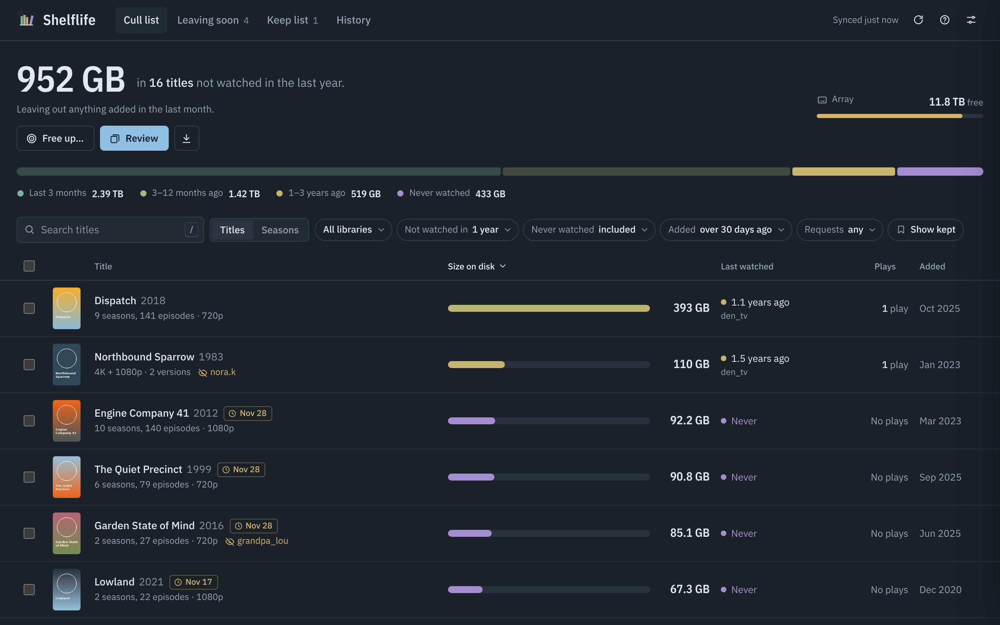

Shelflife lists every movie and TV show that nobody has watched in a while (or ever), sorted by how much disk it takes up, so you can see where culling buys back the most space. Click any title to see its files, who asked for it and its full watch history. Titles you'd never delete go on a keep list and stop showing up.

On its own Shelflife only reads. Connect Sonarr and Radarr and it can delete what you pick, through them, so nothing re-downloads behind your back, or schedule titles to leave in a couple of weeks unless someone watches them first.

## What it does

**Finding what to cut**

- **Cull list.** Movies and whole TV shows in one list, filtered by "not watched in" (1 month to 5 years), with never-watched titles included, left out, or shown alone. Sortable columns: size on disk, last watched, plays, date added, title.
- **Last-watched bar.** Everything in view split by when it was last watched (last 3 months, 3–12 months, 1–3 years, over 3 years, never), sized by disk use. Click a segment to show only that slice.
- **Seasons view.** Every season of every show as its own row, for when the last season of a long show is the dead weight.
- **Free up…** Type a goal (say 500 GB) and Shelflife selects titles from the top of the current list until they add up to it.
- **Skip recent additions.** Anything added in the last 30 days is left out by default, so new downloads don't show up as "never watched".
- **Requests (optional).** With Overseerr or Jellyseerr connected, rows show who asked for a title and flag it when they never watched it. Filter to "requester hasn't watched".
- **Free space (optional).** Mount your array read-only and the header shows how much is free.

**Deciding**

- **Detail panel.** Backdrop, quality badges (4K, Dolby Vision/HDR10, codec, Remux, extra versions), every file path with its size, the request history, a season breakdown and the full watch history. J and K step through the list without closing it.
- **Review mode.** One title at a time, full screen: Delete, Skip or Keep with the arrow keys or a swipe on a phone. Kept titles go straight onto the keep list; deletions queue up and go in one batch at the end. Undo any step.
- **Keep list.** Keep from the panel, from Review, or for a whole selection. Keeping a show keeps all its seasons. Add a note so future-you knows why.
- **What counts as watched.** In settings, ignore plays from specific people (your test plays, a kid on loop) and plays shorter than N minutes.

**Acting** (needs Sonarr and/or Radarr)

- **Delete, one or many.** Select rows and press Delete: Shelflife checks each title against Sonarr/Radarr, shows what can and can't be deleted and how much space comes back, then works through them with live progress. Deleting ten or more asks you to type the count. Plex is asked to rescan afterwards.
- **Leaving soon.** Schedule titles to be deleted in N days (14 by default). If anyone watches one before then, it stays. With a Plex token they also appear in a "Leaving Soon" collection on Plex Home, so the household sees what's going. Extend, cancel or delete now from the Leaving soon tab.
- **History.** Everything deleted, when, how much it freed and how it was deleted, with the running total.
- **Issues.** Where Plex and Sonarr/Radarr disagree: titles in Plex that Radarr or Sonarr doesn't have (with an **Add to Radarr / Sonarr** link), files Radarr or Sonarr has that Plex doesn't show, extra versions or episodes they don't track, titles they have no file for, and two Plex copies that point at one Radarr/Sonarr entry. Rechecked after every sync; ignore anything that's intentional.
- **Sonarr monitoring.** Toggle monitoring for a whole show and for each season from the panel. **Show in Sonarr / Radarr** and **Open in Plex** links.
- **Weekly digest (optional).** A summary to Discord, Slack, ntfy or any webhook: the biggest titles nobody has watched in a year, what's leaving this week and how much was freed. Leaving soon deletions are reported as they happen, with a heads-up the day before.

Works on phones (installable as a PWA), the filters live in the URL so a view can be bookmarked, and nearly everything has a keyboard shortcut (press `?`).

| Title detail | Review mode |
| --- | --- |
| 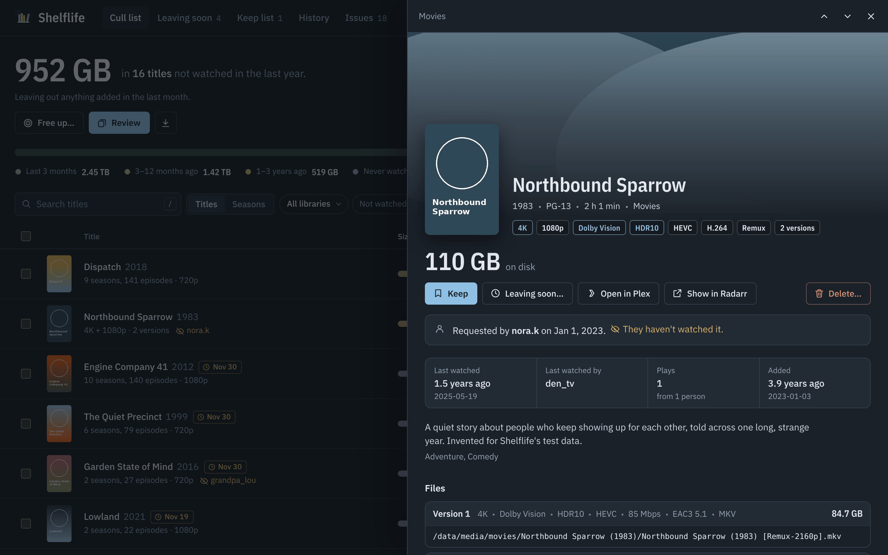 | 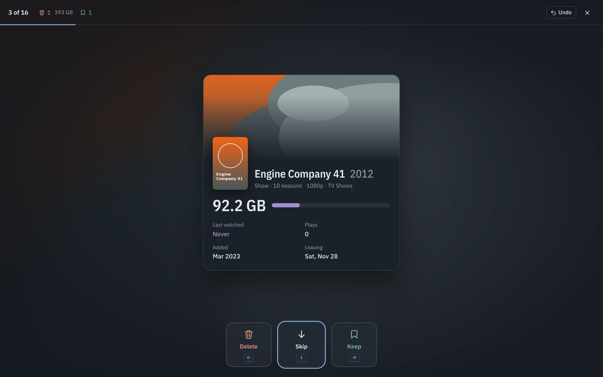 |

| Deleting a selection | Leaving soon |
| --- | --- |
| 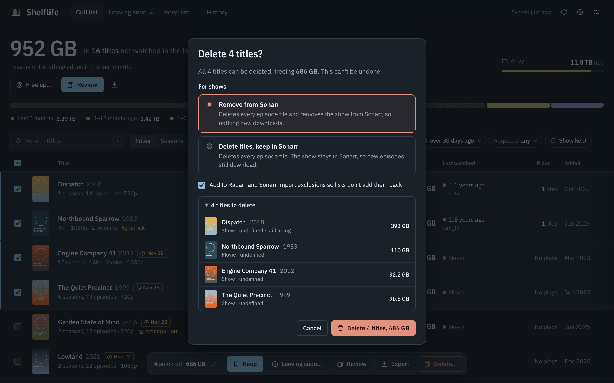 | 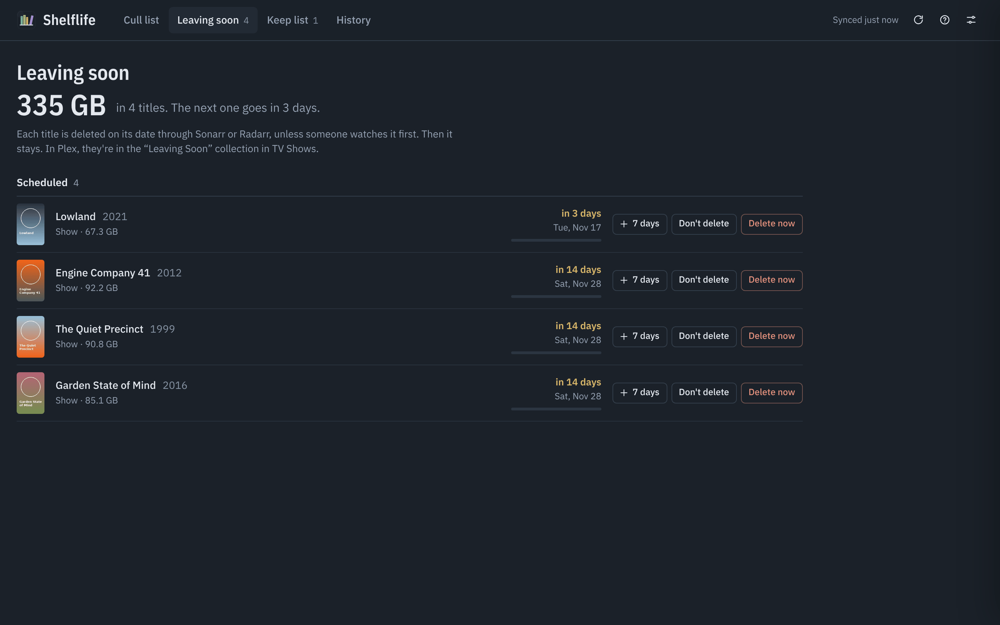 |

| Issues | History |
| --- | --- |
| 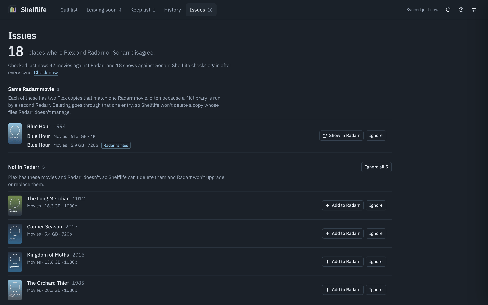 | 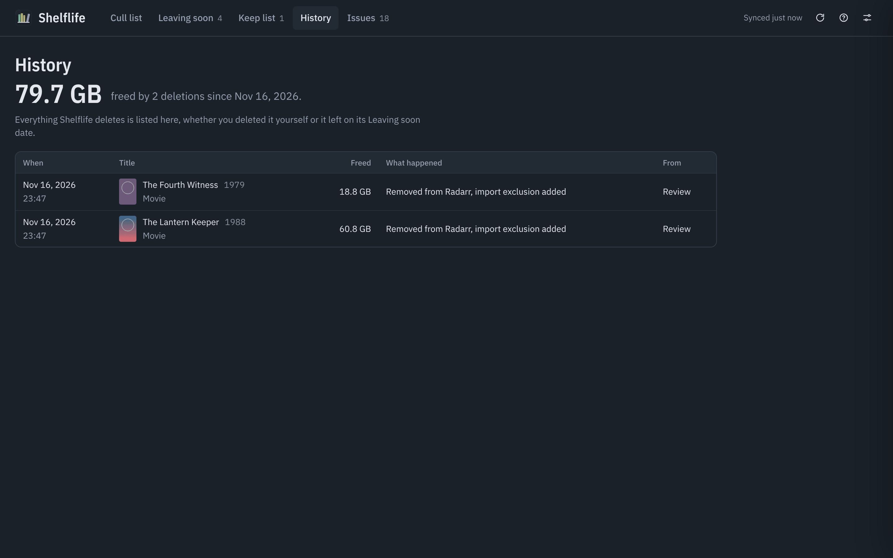 |

<p>
  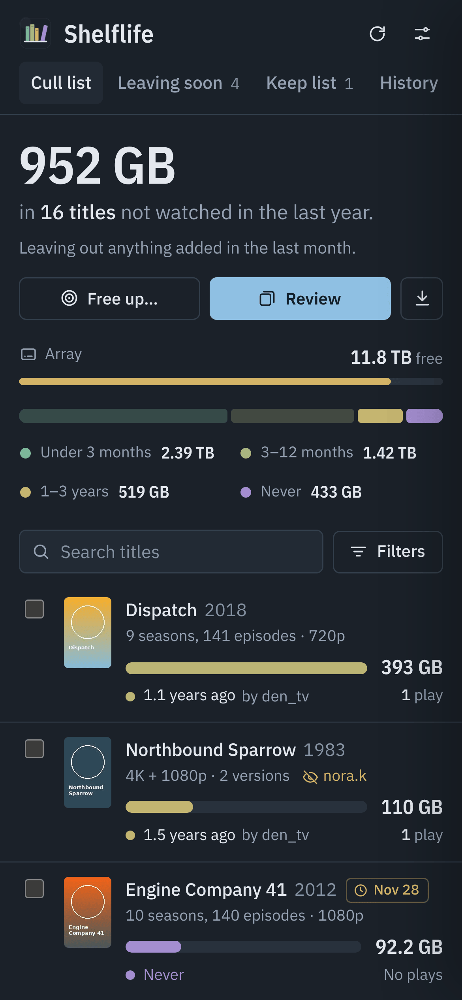
  &nbsp;
  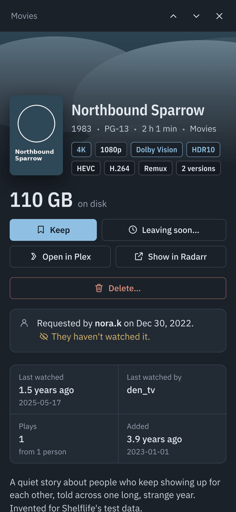
  &nbsp;
  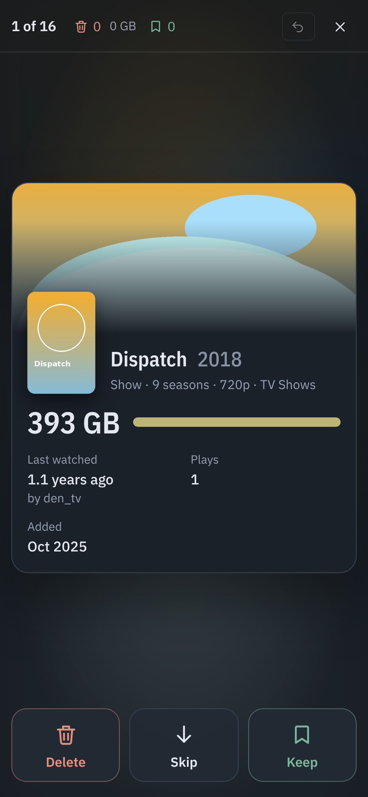
</p>

## Install on Unraid

1. In the Docker tab, choose **Add Container**, and paste this into **Template**:
   `https://raw.githubusercontent.com/au12/shelflife/main/templates/shelflife.xml`
   (or copy `templates/shelflife.xml` to `/boot/config/plugins/dockerMan/templates-user/my-shelflife.xml` and pick it from the template list).
2. Fill in **Tautulli URL** and **Tautulli API key** (Tautulli → Settings → Web Interface).
3. Optional: add a **Plex token** (faster syncs, Open in Plex, the Leaving Soon collection), **Sonarr** / **Radarr** URLs and API keys to delete titles, **Overseerr** for requests, and a **notification URL** for the weekly digest. The template maps `/mnt/user` read-only for the free-space readout; remove that path if you don't want it.
4. Apply, then open the web UI on port 8585. The first sync starts on its own.

This repository is laid out as an Unraid Community Apps repository: `ca_profile.xml` and `LICENSE` at the root, the template in `templates/`.

## Docker / Compose

```yaml
services:
  shelflife:
    image: ghcr.io/au12/shelflife:latest
    container_name: shelflife
    ports:
      - "8585:8585"
    volumes:
      - /mnt/user/appdata/shelflife:/config
      - /mnt/user:/storage/Array:ro          # optional: free-space readout
    environment:
      TAUTULLI_URL: http://192.168.1.10:8181
      TAUTULLI_API_KEY: your-tautulli-api-key
      # PLEX_TOKEN: your-plex-token        # optional, see below
      # SONARR_URL: http://192.168.1.10:8989
      # SONARR_API_KEY: your-sonarr-api-key
      # RADARR_URL: http://192.168.1.10:7878
      # RADARR_API_KEY: your-radarr-api-key
      # OVERSEERR_URL: http://192.168.1.10:5055
      # OVERSEERR_API_KEY: your-overseerr-api-key
      # NOTIFY_URL: https://discord.com/api/webhooks/...
      # TZ: America/Chicago                  # for the digest schedule
    restart: unless-stopped
```

## Settings

| Variable | Default | What it does |
| --- | --- | --- |
| `TAUTULLI_URL` | | Tautulli base URL, including any HTTP root. Required. |
| `TAUTULLI_API_KEY` | | Tautulli API key. Required. |
| `PLEX_TOKEN` | | Optional. Reads file sizes straight from Plex (see below). |
| `PLEX_URL` | from Tautulli | Plex address, only used with a token. Defaults to the one Tautulli uses. |
| `SONARR_URL` / `SONARR_API_KEY` | | Optional. Delete shows and seasons, change monitoring. |
| `RADARR_URL` / `RADARR_API_KEY` | | Optional. Delete movies. |
| `SONARR_PUBLIC_URL` / `RADARR_PUBLIC_URL` | same as the URL | Address your browser uses for the Show in Sonarr/Radarr links, if different (e.g. behind a reverse proxy). |
| `OVERSEERR_URL` / `OVERSEERR_API_KEY` | | Optional. Shows who requested what. `JELLYSEERR_URL` / `JELLYSEERR_API_KEY` work too. |
| `NOTIFY_URL` | | Optional. Discord or Slack webhook, ntfy topic URL, or any URL that accepts a JSON POST (`{title, message, url}`). |
| `DIGEST_DAY` / `DIGEST_HOUR` | `sun` / `9` | When the weekly digest goes out (`mon`…`sun`, or `off`), in `TZ`. |
| `PUBLIC_URL` | | Address of Shelflife itself, linked from notifications. |
| `TZ` | `UTC` | Time zone for the digest schedule. Unraid sets this for you. |
| `STORAGE_DIR` | `/storage` | Every folder mounted under here shows its free space (read-only is fine). |
| `DELETED_HIDE_DAYS` | `7` | How long deleted titles stay hidden while Plex catches up. |
| `SYNC_INTERVAL_HOURS` | `6` | How often to read new watch history (a quick sync). You can also sync from the UI. |
| `FULL_SYNC_HOURS` | `24` | How often to reread everything, including file sizes and quality. |
| `IGNORE_LIBRARIES` | | Comma-separated library names or ids to leave out. |
| `SYNC_CONCURRENCY` | `4` | Parallel Tautulli requests when walking TV seasons. |
| `AUTH_USER` / `AUTH_PASS` | | Optional. Turns on the sign-in page. |
| `VERIFY_SSL` | `true` | Set `false` for self-signed Tautulli/Plex certificates. |
| `PUID` / `PGID` | `99` / `100` | Owner of files in `/config`. |
| `PORT` | `8585` | Port inside the container. |

Ignored users, the minimum play length and the Leaving soon defaults are set in the web UI and stored in `/config`.

### Sizes: Tautulli vs. a Plex token

Tautulli's API reports movie file sizes directly, but not show sizes. Without a Plex token, Shelflife walks every show and season through Tautulli and adds up the episodes. That works, but on a library with hundreds of shows the sync takes a few minutes, and multi-version movies only count their first version.

With `PLEX_TOKEN` set, Shelflife asks Plex for every movie and episode in one request per library. Syncs take seconds and every version and part counts toward the size. ([How to find your Plex token](https://support.plex.tv/articles/204059436-finding-an-authentication-token-x-plex-token/).)

### Deleting with Sonarr and Radarr

Delete buttons appear once Shelflife finds the title in Sonarr or Radarr. It matches on the TVDB/TMDB/IMDb ids Plex has for the title, then falls back to the title, which then has to agree on the year (give or take one) so a remake with the same name never matches. If a title isn't found, the dialog says so and leaves it out; the Issues tab lists every title that isn't found.

| What you delete | What happens |
| --- | --- |
| A movie | Radarr removes the movie and deletes its files. Optionally adds it to Radarr's import exclusions so lists don't re-add it. |
| A show: **Remove from Sonarr** | Sonarr deletes every episode file and removes the series. Optionally adds it to Sonarr's import list exclusions. |
| A show: **Delete files, keep in Sonarr** | Sonarr deletes every episode file. The series stays, so new episodes still download. Episodes that have already aired are unmonitored so Sonarr doesn't grab them again; fully aired seasons are unmonitored as a whole. |
| A season | Sonarr deletes that season's episode files and, by default, unmonitors them the same way. |

Every delete goes through a confirmation that lists exactly what will go and how much space it frees. Titles on the keep list (or seasons of a kept show) can't be deleted until you stop keeping them; this is checked again at the moment of deletion.

If two Plex copies match one Radarr movie or Sonarr series (typically a 4K library run by a second Radarr that Shelflife isn't connected to), a delete through that entry removes whichever copy it manages. Shelflife compares sizes: it refuses to delete a copy whose files are clearly the other one, and warns when it can't tell.

After a delete, Shelflife asks Plex to rescan the library (with a Plex token). Until Plex catches up, deleted titles stay hidden for `DELETED_HIDE_DAYS` (7 by default) so they don't come back on the next sync.

### Leaving soon

Scheduling a title gives it a delete date. Shelflife checks every minute: anything watched since it was scheduled (by someone whose plays count, for longer than your minimum) is spared and taken off the list; anything due is deleted through Sonarr or Radarr, after a fresh sync so a last-minute watch still counts. A failed delete is retried every hour for a day, then shown under **Needs attention**. Adding a title to the keep list also takes it off Leaving soon.

With a Plex token, each library gets a "Leaving Soon" collection holding exactly the scheduled titles, pinned to Plex Home by default. You can rename it or turn it off in settings. Shelflife only edits collections it created (it marks them in the summary).

### Issues

After each sync (and whenever you press **Check now**), Shelflife reads the full Radarr and Sonarr catalogs and matches every Plex movie and show the same way it does before a delete, so the tab shows exactly what a delete would do. It flags:

| Issue | What it means |
| --- | --- |
| Not in Radarr / Sonarr | Plex has it, Radarr or Sonarr doesn't: Shelflife can't delete it and nothing upgrades it. **Add to Radarr / Sonarr** opens their add page already searching for it by TMDB/TVDB id. |
| In Radarr / Sonarr, not in Plex | They have files for it, but it isn't in any Plex library Shelflife reads (often a folder outside your Plex libraries, or a library in `IGNORE_LIBRARIES`). |
| Same Radarr movie / Sonarr show | Two Plex copies match one entry. The copy whose size matches Radarr's/Sonarr's files is marked. |
| No file in Radarr / Sonarr | Plex plays it but they have no file on record, so a monitored title may download again. |
| More in Plex than Radarr tracks / Episodes Sonarr doesn't track | Usually an extra version, or episodes added by hand. Deleting through Radarr/Sonarr can leave those behind. |
| Plex is behind Radarr / Sonarr | They have a newer file or more episodes than Plex shows; a Plex library scan fixes it. |

Movies compare total size on disk (a gap of more than 1% and 200 MB counts); shows compare episode counts, season by season. **Ignore** hides an issue for good (it stays hidden after later checks); **Ignore all** does a whole group, handy for a home-videos library Radarr was never meant to manage. Without a Plex token, ids for titles that don't match by name are looked up through Tautulli and cached for a month.

### Signing in

Set `AUTH_USER` and `AUTH_PASS` to put Shelflife behind a sign-in page. Sessions last 12 hours, or 30 days with "Keep me signed in", and live in a signed, HTTP-only cookie. Changing the password signs everyone out. Five wrong passwords from one address lock it out for 5 minutes. Basic auth with the same credentials still works for scripts (`curl -u user:pass .../api/items`).

| Desktop | Phone |
| --- | --- |
| 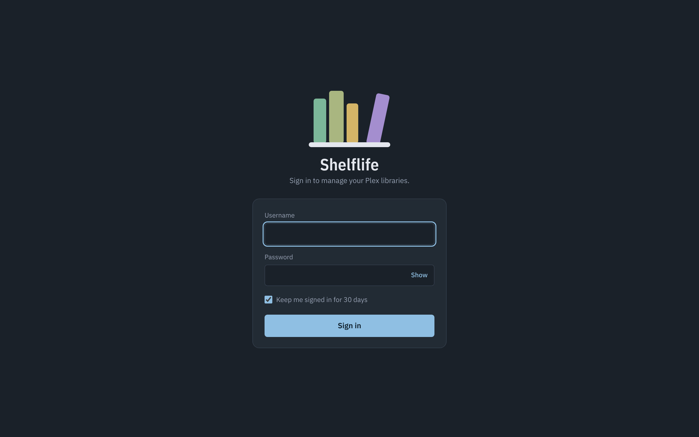 | 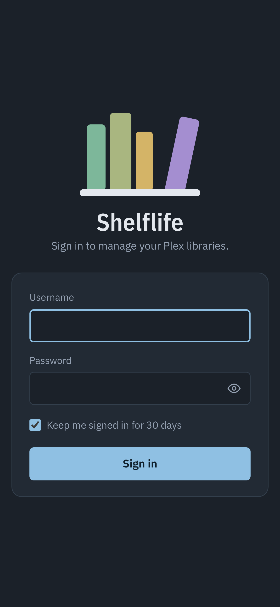 |

If you put Shelflife behind a reverse proxy with HTTPS, the cookie is marked Secure automatically.

### How "watched" is decided

A title's last-watched date is the most recent play of it (or any of its episodes) in Tautulli's history, counting partial plays, minus anyone you've ignored and anything shorter than your minimum. History is grouped the same way Tautulli groups it, so a play paused and resumed later counts once.

One caveat: Tautulli ties history to Plex rating keys. If a show was deleted and re-added in Plex, it gets new keys and its old plays won't attach, so it can look never-watched. Check the history panel before deleting anything that surprises you.

## Development

```sh
pip install -r requirements.txt pillow playwright
python dev/mock_tautulli.py &      # fake Tautulli + Plex with invented data on :8181
CONFIG_DIR=./config TAUTULLI_URL=http://localhost:8181 TAUTULLI_API_KEY=x \
  uvicorn app.main:app --reload --port 8585
python dev/screenshots.py          # regenerate docs/screenshots
python dev/test_api.py             # end-to-end API checks (starts its own mock and instances)
python dev/test_ui.py              # browser checks at desktop and phone sizes, incl. text contrast
```

Add `PLEX_TOKEN=x` to exercise the Plex-direct path against the same mock, `SONARR_URL=http://localhost:8181/sonarr SONARR_API_KEY=x RADARR_URL=http://localhost:8181/radarr RADARR_API_KEY=x` for the mock Sonarr and Radarr, and `OVERSEERR_URL=http://localhost:8181/seerr OVERSEERR_API_KEY=x` for mock requests. The screenshots use the mock's invented titles, users and posters.

The front end is plain JavaScript with no build step: `app/static/js/` holds one file per area (list, detail panel, bulk actions and Review, tabs, start-up).

### Releasing

Add a `### x.y.z (date)` section to `<Changes>` in `templates/shelflife.xml`, put `x.y.z` in `VERSION`, and push to `main`. The Release workflow tags the commit, publishes a GitHub release with those notes, and builds the `x.y.z`, `x.y` and `latest` images. Pushes that don't change `VERSION` only update `latest`.

## License

MIT. IBM Plex Sans is bundled under the SIL Open Font License (`app/static/fonts/OFL.txt`).
